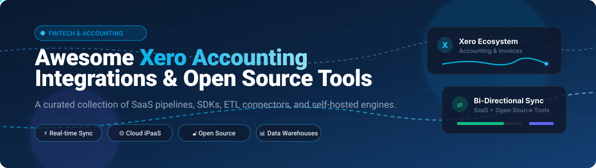

# 🌟 Awesome Xero Accounting Integration

  

  
  
  
  
  
  

> 🚀 A curated directory of premier **Xero Accounting Integration** platforms, enterprise iPaaS connectors, SaaS sync pipelines, open-source SDKs, REST APIs, and self-hosted accounting alternatives for syncing real-time financial ledger data with Xero.  
> 🌟 *Star this repository if you find it helpful for your fintech and bookkeeping workflows!* 🌟

---

## 📑 Table of Contents

- [🌐 Sector Overview & Market Dynamics](#-sector-overview--market-dynamics)
- [🟦 SaaS / Hosted Platforms](#-saas--hosted-platforms)
- [🟩 Open-Source Software & SDKs](#-open-source-software--sdks)
- [📊 Comparison at a Glance](#-comparison-at-a-glance)
- [📈 Star History](#-star-history)
- [💖 Support & Sponsorship](#-support--sponsorship)
- [🤝 Contributing](#-contributing)
- [📄 License](#-license)

---

## 🌐 Sector Overview & Market Dynamics

The global accounting software market is valued at approximately **$15.7 billion** and is projected to expand to over **$27.5 billion by 2030** (growing at a CAGR of ~8.5%), fueled by cloud adoption, automated invoicing, and real-time reconciliation. The sector displays **moderate fragmentation transitioning toward consolidation**: while enterprise cloud ERP and small-business accounting platforms (Xero, Intuit QuickBooks, NetSuite) form a high-concentration core, the broader ecosystem of specialized synchronization hubs, ETL pipelines, vertical connectors, and open-source tooling remains dynamic and fragmented to serve domain-specific accounting compliance across different geographic regions.

---

## 🟦 SaaS / Hosted Platforms

Below is an overview of leading commercial, cloud-hosted platforms providing native connectors and automated data sync pipelines for Xero, sorted descending by company size, valuation, and enterprise revenue scale.

| Platform | Company Scale / Valuation / Revenue | Starting Tier Pricing | Free Tier / Free Trial Limits | Type & Key Capabilities |
|:---|:---|:---|:---|:---|
| **[Zapier](https://zapier.com)** | **$5.0B valuation** ($250M+ ARR) | **$19.99/month** (billed annually for Starter tier with 750 tasks/mo) | **Free Forever Plan:** 100 tasks/month, up to 5 single-step Zaps, 15-minute update frequency *(Note: Xero integration triggers/actions require paid tier or active trial)* | General-purpose iPaaS automation linking Xero to 7,000+ apps. Automates invoices, contact creation, bills, and purchase order sync. |
| **[Fivetran](https://fivetran.com)** | **$5.6B valuation** ($300M+ ARR) | **$0.40 / Credit** (Pay-as-you-go Starter Plan; Standard at ~$60/mo for 100k MAR) | **14-Day Free Trial:** Unlimited MAR (Monthly Active Rows) and full connector access for 14 days; plus ongoing Free Tier up to 500k MAR/month for standard connectors | Managed enterprise ELT data replication syncing Xero journals, assets, transactions, and payroll directly into cloud data warehouses (Snowflake, BigQuery). |
| **[Workato](https://www.workato.com)** | **$5.7B valuation** ($150M+ ARR) | **$10,000/year** base platform fee + per-recipe pack pricing | **30-Day Free Trial:** Full platform access with sandbox test recipes and guided enterprise connector onboarding | Enterprise workflow orchestrator offering 150+ pre-built Xero triggers and actions, bidirectional reconciliation, custom actions, and batch sync. |
| **[Chargebee](https://www.chargebee.com)** | **$3.5B valuation** ($100M+ ARR) | **$599/month** (Performance Tier, billed annually with up to $100k/mo revenue included) | **Free Trial / Starter:** Sandbox testing mode with full API access; plus 14-day free trial on premium tiers with simulated transaction limits | Subscription billing automation synchronizing multi-currency invoices, credit notes, payments, taxes, and chart-of-accounts mapping into Xero. |
| **[Make](https://www.make.com)** *(Celonis)* | **$13.0B parent valuation** ($100M+ Make ARR) | **$9.00/month** (Core tier, billed annually for 10,000 operations/month) | **Free Forever Plan:** 1,000 operations/month, 100 MB data transfer, 15-minute minimum interval, 2 active scenarios | Visual workflow builder with granular Xero modules covering accounts, bank transactions, credit notes, invoices, and webhook-driven event triggers. |
| **[Celigo](https://www.celigo.com)** | **$500M+ valuation** ($80M+ ARR) | **$600/month** (Standard iPaaS edition billed annually) | **30-Day Free Trial:** Full access to integrator.io platform, pre-built Xero connector endpoints, and flow manager | Enterprise iPaaS built for e-commerce, CRM, and NetSuite ecosystems requiring OAuth2-based accounting sync to Xero. |
| **[Stitch](https://www.stitchdata.com)** *(Talend/Qlik)* | **$300M acquisition** (Talend subsidiary) | **$100/month** (Standard plan for 5 million replicated rows/month) | **14-Day Free Trial:** Unlimited row volume replication during 14 days with access to Xero connector endpoints | Incremental replication pipeline streaming Xero bank transactions, manual journals, invoices, and organization settings into warehouses. |
| **[OneSaas](https://www.quickbooks.com)** *(Intuit)* | **$120M acquisition** (Intuit subsidiary) | **$29/month** (Base e-commerce bridge subscription) | **7-Day Free Trial:** 7 days full access connecting 1 storefront with up to 50 sync transactions | Managed e-commerce hub-and-spoke connector syncing orders, inventory, and sales data between e-commerce stores/POS and Xero. |
| **[Dataddo](https://www.dataddo.com)** | **$20M valuation** ($5M+ ARR) | **$99/month** (Standard Tier for 3 data pipelines/flows) | **14-Day Free Trial:** Full access to all sources and destinations for 14 days; plus Free Plan with 1 data flow and weekly scheduled sync | No-code data pipeline extracting the full Xero record model to data warehouses, data lakes, and BI dashboards with a Data Quality Firewall. |

---

## 🟩 Open-Source Software & SDKs

Curated open-source Xero connectors, official software development kits (SDKs), AI integration tooling, and self-hosted accounting alternatives, sorted descending by GitHub Stars_Count:

| Repository & Tool | Community GitHub_Stars | Tech Stack | License | Description & Integration Capabilities |
|:---|:---:|:---|:---|:---|
| **[Activepieces](https://github.com/activepieces/activepieces)** |  | TypeScript, Node.js | MIT | Extensible open-source automation platform with an official, MIT-licensed Xero connector piece for webhook triggers and invoice/contact actions. |
| **[Airbyte Xero Connector](https://github.com/airbytehq/airbyte)** |  | Python, Java | MIT / ELv2 | Production-grade ELT data pipeline replicating accounts, bank transactions, invoices, and credit notes from Xero to Postgres, Snowflake, and BigQuery. |
| **[Bigcapital](https://github.com/bigcapitalhq/bigcapital)** |  | TypeScript, Node.js, React | AGPL-3.0 | Modern open-source financial accounting and double-entry bookkeeping platform with reporting and invoicing; a self-hostable alternative to Xero. |
| **[Xero MCP Server](https://github.com/XeroAPI/xero-mcp-server)** |  | TypeScript, Node.js | MIT | Official Model Context Protocol (MCP) server from Xero enabling LLM agents and AI coding assistants to securely query and manage Xero accounting data. |
| **[calcinai/xero-php](https://github.com/calcinai/xero-php)** |  | PHP | MIT | Robust, community-favorite PHP client library for the Xero Accounting API featuring an intuitive ORM-like abstraction and clean OAuth interface. |
| **[freakboy3742/pyxero](https://github.com/freakboy3742/pyxero)** |  | Python | BSD-3-Clause | Elegant, Pythonic library for interacting with the complete Xero Accounting, Payroll, and Files REST APIs. |
| **[Xero Official Node SDK](https://github.com/XeroAPI/xero-node)** |  | TypeScript, Node.js | MIT | Official Xero Node SDK generated from OpenAPI specs supporting OAuth 2.0 authentication, token refresh, and full accounting endpoints. |
| **[waynerobinson/xeroizer](https://github.com/waynerobinson/xeroizer)** |  | Ruby | MIT | Veteran Ruby gem providing full ActiveModel-style validation and communication with the Xero Accounting API. |
| **[Xero Official Python SDK](https://github.com/XeroAPI/xero-python)** |  | Python | MIT | Official Xero OAuth 2.0 client SDK for Python developers with automatic token refresh, token storage adapters, and complete Accounting API support. |
| **[Xero .NET Standard SDK](https://github.com/XeroAPI/Xero-NetStandard)** |  | C#, .NET | MIT | Official .NET client library targeting .NET Standard 2.0, supporting Xero Accounting, Assets, Files, and AU/US/UK Payroll APIs. |
| **[Xero Official Java SDK](https://github.com/XeroAPI/Xero-Java)** |  | Java | MIT | Official Java client library for integrating enterprise Java applications with Xero Accounting and Bank Feeds APIs. |
| **[xero-laravel](https://github.com/langleyfoxall/xero-laravel)** |  | PHP, Laravel | MIT | Laravel package providing an expressive, Eloquent-like syntax for querying and updating Xero accounting records. |
| **[LedgerSync](https://github.com/LedgerSync/ledger_sync)** |  | Ruby | Apache-2.0 | Programmatic abstraction layer and sync framework for standardizing financial data pipelines across Xero, QuickBooks, and NetSuite. |
| **[Xero Official Ruby SDK](https://github.com/XeroAPI/xero-ruby)** |  | Ruby | MIT | Official Ruby gem for Xero OAuth 2.0 generated from Xero-OpenAPI specifications. |
| **[dubbl](https://github.com/dubbl-org/dubbl)** |  | TypeScript, Next.js, Postgres | AGPL-3.0 | API-first, self-hostable alternative to Xero featuring double-entry bookkeeping, invoicing, bank reconciliation, and built-in AI MCP server. |
| **[TPT OpenLedger](https://github.com/smancer-dev/tpt-openledger)** |  | Rust, Tauri, React | MIT / Apache-2.0 | Desktop-native, local-first double-entry accounting application with SQLCipher encryption, built as a zero-cloud alternative to Xero. |
| **[baton-xero](https://github.com/ConductorOne/baton-xero)** |  | Go | Apache-2.0 | Identity governance connector syncing Xero organizations, roles, and member permissions with the Baton access ecosystem. |

---

## 📊 Comparison at a Glance

| Solution | Deployment Type | Primary Function | Sync Architecture | Open Source | Target Audience |
|:---|:---|:---|:---|:---:|:---|
| **Make** | Cloud SaaS | Multi-app Automation | Bidirectional / Webhooks | ❌ | Visual workflow builders & SMBs |
| **Workato** | Cloud SaaS | Enterprise iPaaS | Bidirectional / Event-driven | ❌ | Enterprise IT & operations teams |
| **Fivetran** | Managed Cloud | Data Replication / ELT | Xero → Data Warehouse | ❌ | Data engineering & analytics teams |
| **Zapier** | Cloud SaaS | No-code Automation | Bidirectional / Polling + Webhooks | ❌ | Non-technical business operators |
| **Chargebee** | Cloud SaaS | Subscription Billing | Chargebee → Xero Sync | ❌ | SaaS & recurring revenue businesses |
| **Celigo** | Cloud SaaS | iPaaS Integration | Bidirectional / Custom Flows | ❌ | E-commerce merchants & NetSuite users |
| **Stitch** | Managed Cloud | SaaS ELT Pipeline | Xero → Data Warehouse | ❌ | BI analysts & data engineers |
| **OneSaas** | Cloud SaaS | Store & POS Bridge | Storefront → Xero | ❌ | Retail & e-commerce shop owners |
| **Dataddo** | Cloud SaaS | Managed Data Pipeline | Xero → Warehouses & BI | ❌ | Financial reporting teams & analysts |
| **Activepieces** | Self-Hosted / Cloud | Workflow Automation | Bidirectional / Webhooks | ✅ | Developers wanting self-hosted automation |
| **Airbyte Xero** | Self-Hosted / Cloud | Open-Source ELT | Xero → DWH / Database | ✅ | Data engineers avoiding vendor lock-in |
| **Bigcapital** | Self-Hosted | Full Accounting Platform | Direct / Independent | ✅ | Organizations seeking self-hosted accounting |
| **Xero MCP Server** | Local / Server | AI Agent Integration | Bidirectional Model Context | ✅ | AI engineers & coding assistant workflows |
| **Xero SDKs** | Library / Package | API Integration Client | Custom Application ↔ Xero | ✅ | Software engineers building custom tools |
| **dubbl** | Self-Hosted | API-First Accounting | Direct / Independent | ✅ | Modern developers owning financial data |
| **LedgerSync** | Ruby Gem | Multi-ledger Abstraction | App ↔ Accounting Ledger | ✅ | Ruby & Rails financial app engineers |
| **baton-xero** | CLI / Container | Identity Governance | Xero → Baton Access Graph | ✅ | SecOps & IAM compliance auditors |

---

## 📈 Star History

---

## 💖 Support & Sponsorship

Thank you for exploring the **Awesome Xero Accounting Integration** repository! ☕✨

If this curated guide has saved you research hours or helped streamline your financial integrations:
- 🌟 **Star** this repository to help other developers discover it!
- 🍴 **Fork** it to contribute your own favorite tools and packages.
- 📢 **Share** it with your fintech peers and engineering colleagues.
- ☕ **Sponsor & Buy a Coffee:** Support ongoing maintenance via the [GitHub Sponsor Dashboard](https://github.com/sponsors/ishandutta2007).

---

## 🤝 Contributing

Contributions are always welcome! 🛠️

To add a new open-source Xero tool, SDK, or hosted connector:
1. 🍴 Fork the repository.
2. 🌿 Create your feature branch (`git checkout -b feature/awesome-xero-tool`).
3. ✍️ Add your project with proper descriptions, tech stack, and verifiable links.
4. 🚀 Push to the branch and open a Pull Request.

Please ensure all submissions adhere to the [Awesome-Awesome-Awesome](https://github.com/ishandutta2007/Awesome-Awesome-Awesome) community guidelines.

---

## 📄 License

This repository is licensed under the creative [CC0 1.0 Universal (Public Domain)](LICENSE). Individual referenced tools and libraries retain their respective licenses.
